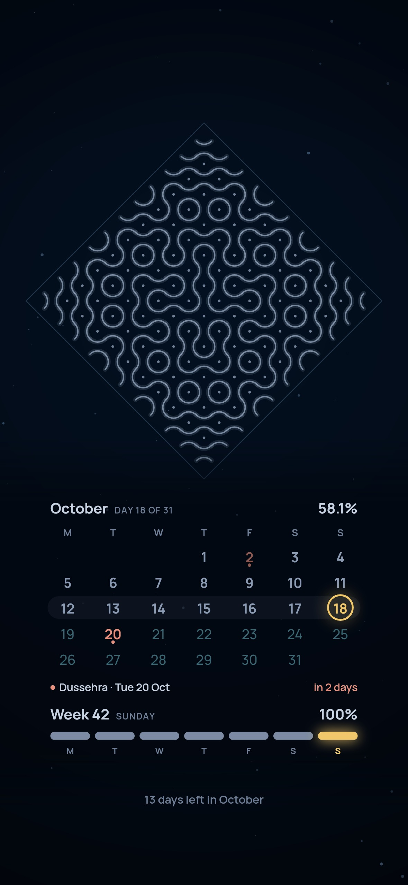
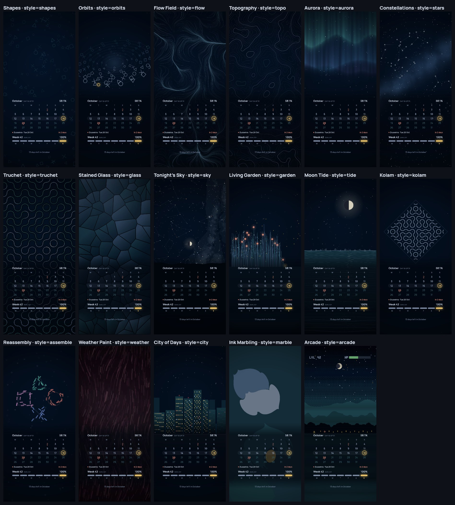

# Dayglow

**Your day, glowing on your lock screen.** Dayglow is a tiny serverless API that draws a fresh iPhone lock screen wallpaper every time you ask: generative art up top, your month, week or year progress below, and the next public holiday counting down. Point an iOS Shortcut at it and your wallpaper updates itself.

<p align="center"></p>

- **17 art styles**, from flow fields and contour maps to the real sky over your city tonight, a sea that follows the moon, a kolam pattern and a pixel-art level.
- **Different on every pull**, or pinned to a seed you like. Daily and hourly seeds are built in.
- **Calendar views** for month and week, or the whole year as 365 symbols. Holidays are marked, and the next one counts down.
- **Festive touches** on Diwali, Holi, Eid, Christmas and national days.
- **One function, no database, no API keys.** It deploys free on Vercel's Hobby plan.



## Quick start

1. **Deploy your own copy.**

   [](https://vercel.com/new/clone?repository-url=https%3A%2F%2Fgithub.com%2Faaditya420%2Fdayglow&project-name=dayglow&repository-name=dayglow)

2. **Set your home location** (optional). In Vercel, open **Project → Settings → Environment Variables** and add `WALLPAPER_TZ`, `WALLPAPER_LAT` and `WALLPAPER_LON` (see [Configuration](#configuration)). Redeploy afterwards.

3. **Open the image** in a browser to check it: `https://<your-project>.vercel.app/month.png`. If you see a Vercel login page instead, turn off Vercel Authentication for production under **Settings → Deployment Protection** (Standard Protection keeps previews private and production public).

4. **Automate it with Shortcuts** (see below).

## iPhone setup with Shortcuts

1. Create a new Shortcut with two actions:
   - **Get Contents of URL**, with your wallpaper URL, for example `https://<your-project>.vercel.app/month.png?style=gallery`.
   - **Set Wallpaper Photo**: tap the wallpaper name and choose **Current**, select **Lock Screen**, and turn off **Show Preview** and **Crop to Subject**.
2. Run it once to check.
3. In **Automation**, add a **Time of Day** trigger (for example 12:05 AM, daily) and choose **Run Immediately**. Turn off **Notify When Run**.

### Matching lock and home screens

Each pull picks a new random design, so two separate pulls give two different wallpapers. To get the same art on both screens with the calendar placed for each, share one seed:

1. **Random Number** (1 to 999999).
2. **Get Contents of URL**: `https://<your-project>.vercel.app/month.png?style=gallery&seed=` followed by the Random Number. Then **Set Wallpaper Photo** → **Lock Screen**.
3. **Get Contents of URL**: the same URL with `&screen=home` added at the end, and the same Random Number. Then **Set Wallpaper Photo** → **Home Screen**.

The home screen photo only changes if that wallpaper's Home Screen is set to show its own photo. If it doesn't update, long-press the Lock Screen, tap **Customize → Home Screen**, and pick any photo once.

Want a new design more often? Add more Time of Day automations, or trigger on events such as opening an app, stopping an alarm or connecting the charger. To pick between looks, put a **Choose from Menu** action before Get Contents of URL with one URL per option.

> If the Shortcut runs but your lock screen doesn't change, the action is updating a wallpaper that isn't the active one. Choose **Current** in the Set Wallpaper action.

## API

`GET /api/wallpaper` returns an image. These shortcuts are also available:

| Path | Same as |
| --- | --- |
| `/month.png` | `/api/wallpaper?view=month` |
| `/year.png` | `/api/wallpaper?view=year` |
| `/art.png` | `/api/wallpaper?style=gallery` |

Add query parameters to any of them, for example `/month.png?style=sky&lat=19.07&lon=72.88`.

| Parameter | Values | Default | What it does |
| --- | --- | --- | --- |
| `style` | a style id below, or `gallery` | `shapes` | The art. `gallery` picks a random style on every pull. |
| `view` | `month`, `year`, `none` | `month` | The calendar drawn over the art. `none` is art only. |
| `screen` | `lock`, `home` | `lock` | `home` moves the calendar up into the space between a row of widgets and the page dots, and drops the footer and caption that the dock would cover. Styles with a ground line (`arcade`, `city`, `garden`, `tide`, `sky`) end at the bottom of the clock on `lock` and of the widget row on `home`, leaving a gap above the calendar. |
| `seed` | `random`, `daily`, `hourly`, a number or any text | `random` | Random gives a new design each pull. Pin a number to keep one you like. |
| `palette` | `auto`, `random`, `midnight`, `ember`, `ocean`, `forest`, `rose`, `violet`, `mono`, `dawn` | `auto` | `auto` follows the hour of the day (or the season, with `tod=0`). |
| `tod` | `1`, `0` | `1` | With `palette=auto`, colour by the local hour: every hour has its own blend, darkest around 3 AM and brightest at noon, through dawn, golden hour and dusk. `0` uses a palette for the season instead. |
| `festive` | `1`, `0` | `1` | Holiday decorations. |
| `label` | `1`, `0` | on for `gallery` | A small caption with the style, details and seed. |
| `scrim` | `0` to `1` | `0.85` (`0` for `shapes`) | How much the art is darkened behind the calendar. |
| `lat`, `lon` | coordinates | from env | Location for `sky` and `weather`. |
| `tz` | IANA zone, e.g. `Europe/London` | from env | Decides what "today" is. |
| `date` | `YYYY-MM-DD` or `YYYY-MM-DDTHH:MM` | now | Preview any day, e.g. `2026-11-08` for Diwali. |
| `w`, `h` | 300–2000, 600–4400 | `1179`, `2556` | Image size in pixels. |
| `format` | `png`, `jpg`, `webp` | `png` | JPEG and WebP are smaller and render several times faster. |

Invalid values never fail the request: they fall back to defaults and are listed in an `X-Wallpaper-Warning` response header. Every response also carries `X-Wallpaper-Style`, `X-Wallpaper-Seed` and `X-Wallpaper-Palette`.

### Common screen sizes

| iPhone | `w` × `h` |
| --- | --- |
| 15, 15 Pro, 16 | 1179 × 2556 |
| 16 Pro | 1206 × 2622 |
| 15 Plus, 15 Pro Max, 16 Plus | 1290 × 2796 |
| 16 Pro Max | 1320 × 2868 |
| 13, 13 Pro, 14 | 1170 × 2532 |

## Styles

| `style` | Name | What changes with the date |
| --- | --- | --- |
| `shapes` | Shapes | Scattered triangles, circles, crosses and squares. |
| `orbits` | Orbits | A marker travels the outer orbit as the month passes. |
| `flow` | Flow Field | Thousands of lines following an invisible current. |
| `topo` | Topography | Map-style contour lines. |
| `aurora` | Aurora | Light curtains over a starry sky. |
| `stars` | Constellations | Invented constellations over a milky band. |
| `truchet` | Truchet | Quarter-arc tiles forming endless tubes. |
| `glass` | Stained Glass | Voronoi cells in leaded glass. |
| `sky` | Tonight's Sky | The real stars, Moon and planets for your location at 9 PM (or now, after dark). |
| `garden` | Living Garden | One stem per day of the year so far; holidays bloom. |
| `tide` | Moon Tide | Sea level follows the real moon phase; one buoy per day left in the month. |
| `kolam` | Kolam | A symmetric pattern traced around a dot grid; coloured on holidays. |
| `assemble` | Reassembly | The four symbols piece themselves together as the month goes on. |
| `weather` | Weather Paint | Today's forecast as paint: wind sets direction, rain adds streaks, temperature picks colours. |
| `city` | City of Days | Every window is a day of the year; past days are lit. |
| `marble` | Ink Marbling | One drop of ink for each day of the month. |
| `arcade` | Arcade | Pixel level for the ISO week, with a health bar for the month and coins for days left. |

`weather` uses [Open-Meteo](https://open-meteo.com) (free, no key). If it can't be reached, the style paints an imagined forecast and says so in the caption.

## Configuration

All optional, set as Vercel environment variables. None of them are secrets.

| Variable | Default | Purpose |
| --- | --- | --- |
| `WALLPAPER_TZ` | `Asia/Kolkata` | Default time zone. |
| `WALLPAPER_LAT`, `WALLPAPER_LON` | `28.6139`, `77.2090` (New Delhi) | Default location for `sky` and `weather`. |
| `WALLPAPER_HOLIDAYS` | `IN` | Holiday calendar in `data/holidays/<CODE>.json`, or `none`. |

### Holidays

`data/holidays/IN.json` lists India's 17 gazetted Central Government holidays for 2026 and 2027, from the DoPT lists. From 2028 the holiday marks and the next-holiday line stay empty until that year's list is added. To add another country, create `data/holidays/<ISO code>.json` with the same shape and set `WALLPAPER_HOLIDAYS`. Pull requests with new calendars or new years are very welcome.

## Local development

Requires Node.js 22.

```sh
npm install
npm run check          # lint + tests
npm run preview        # renders every style into previews/ plus a contact sheet
npx vercel dev         # optional: serve the API at http://localhost:3000
```

`npm run preview -- "view=year&palette=ocean"` passes extra query parameters to every render. Set `WALLPAPER_OFFLINE=1` to skip the weather request.

### Project layout

```
api/wallpaper.js     HTTP handler: validation, caching headers, errors
src/options.js       query parsing and limits
src/render.js        render pipeline
src/overlays.js      calendar views, scrim, festivals, caption
src/styles/          one file per art style, plus index.js
src/core.js          seeded RNG, noise, palettes, drawing primitives
src/time.js          time zone and calendar helpers
src/holidays.js      holiday calendars
src/weather.js       Open-Meteo client with a warm cache
data/holidays/       holiday data
test/                node:test suites
```

## CI/CD

`.github/workflows/ci.yml` runs lint, tests and a dependency audit on every push and pull request. When the Vercel secrets are present it then deploys: pushes to `main` go to production, pull requests from branches in this repository get a preview deployment. Pull requests from forks never receive secrets and are not deployed. CodeQL scans the code weekly and on every change.

To enable deploys in your own fork, add three **repository secrets** under **Settings → Secrets and variables → Actions**:

| Secret | Where to find it |
| --- | --- |
| `VERCEL_TOKEN` | Vercel → Account Settings → Tokens. Create a token scoped to the team that owns the project. |
| `VERCEL_ORG_ID` | Vercel → Team Settings → General → Team ID (or `orgId` in `.vercel/project.json` after `npx vercel link`). |
| `VERCEL_PROJECT_ID` | Vercel → Project → Settings → General → Project ID. |

Optionally add a repository **variable** `PRODUCTION_URL` (for example `https://dayglow.vercel.app`) and the workflow will check that the deployed endpoint returns an image. Without secrets the deploy job is skipped, so forks still get green checks.

If you also connected the repository through Vercel's Git integration, disable one of the two so each push deploys once.

## Performance and limits

- A full-size render takes about 0.2–1 s depending on the style. PNG encoding is the largest cost for busy styles, so `format=jpg` is the fastest option.
- Image size is capped at 2000 × 4400 to keep memory and run time bounded.
- Random pulls are sent with `Cache-Control: no-store`. Pinned seeds can be cached by Vercel's CDN until the next hour, which makes repeated pulls nearly free.
- Every uncached pull runs the function and counts towards your Vercel plan's usage. If you share your deployment's URL publicly, add a rate-limit rule for `/api/wallpaper` under **Firewall** in your Vercel project, so other people's traffic can't use up your quota.

## Contributing

Ideas, new styles, holiday calendars and fixes are all welcome. Read [CONTRIBUTING.md](CONTRIBUTING.md) to get started (coding agents: [CLAUDE.md](CLAUDE.md) has the full rules, including Conventional Commits and SemVer), and please follow the [Code of Conduct](CODE_OF_CONDUCT.md). Security issues go through [SECURITY.md](SECURITY.md), not public issues.

## License

[MIT](LICENSE). Third-party data and fonts keep their own licenses; see [THIRD_PARTY_NOTICES.md](THIRD_PARTY_NOTICES.md).
